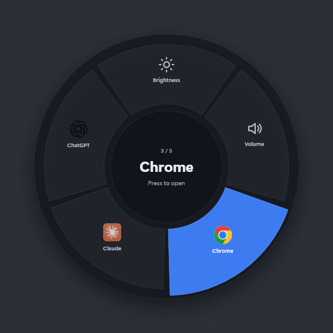
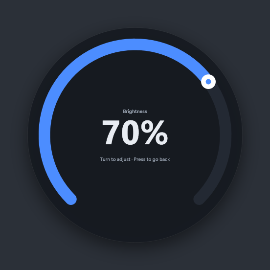

# knob-control

Turn the volume knob on your keyboard into a radial menu for Windows. Rotate to pick, press to open: adjust brightness or volume, or launch and focus apps like Chrome, Claude and ChatGPT.

Built with C# / WPF on .NET 8. Tested on the **Kreo Hive RGB**, and should work with any keyboard whose knob sends the standard volume keys.

<p align="center">
  
  
</p>

## How you use it

| Knob | In the circle | In a gauge (brightness / volume) |
|---|---|---|
| **Turn** | Move between items | Change the level (5% per click) |
| **Press** | Open the item | Go back to the circle |
| **Leave it** | Fades out after 2.5 s | Fades out after 3.5 s |

- When the circle is hidden, the first knob event brings it back without changing anything.
- Pressing an app brings its window to the front (restoring it if minimized), or starts it if it isn't running.
- Volume keys on your other keyboards, such as a laptop's Fn keys, keep working normally.

<p align="center">
  
</p>

## Requirements

- Windows 10 or 11
- [.NET 8 Desktop Runtime](https://dotnet.microsoft.com/download/dotnet/8.0) (to run), or the .NET 8 SDK or newer (to build)
- A keyboard with a volume knob

## Build and run

```powershell
git clone https://github.com/gatikash/knob-control.git
cd knob-control
dotnet build -c Release
.\bin\Release\net8.0-windows\KnobControl.exe
```

The app runs in the system tray (a blue ring icon). Right-click the icon for:

- **Enabled**: turn the menu off, so the knob controls volume as normal again
- **Start with Windows**
- **Edit settings…** and **Reload settings**
- **Exit**

To get a single exe that doesn't need .NET installed:

```powershell
dotnet publish -c Release -r win-x64 --self-contained -p:PublishSingleFile=true -o publish
```

## Settings

The first time it runs, the app creates `%APPDATA%\KnobControl\settings.json`:

```json
{
  "items": [
    { "kind": "brightness", "name": "Brightness" },
    { "kind": "volume", "name": "Volume" },
    { "kind": "app", "name": "Chrome", "appId": "Chrome", "process": "chrome" },
    { "kind": "app", "name": "Claude", "appId": "Claude_pzs8sxrjxfjjc!Claude" },
    { "kind": "app", "name": "ChatGPT", "appId": "OpenAI.Codex_2p2nqsd0c76g0!App" }
  ],
  "step": 5,
  "size": 440,
  "hideAfterMs": 2500,
  "deviceMatch": "VID_320F&PID_5055"
}
```

| Key | Meaning |
|---|---|
| `items` | 2–8 slices, shown clockwise from the top |
| `kind` | `brightness`, `volume` or `app` |
| `appId` | Start-menu app ID. List them with `Get-StartApps` in PowerShell. Works for both Store and regular apps. |
| `path` | Path to an `.exe`, as an alternative to `appId` |
| `process` | Process name used to find an already-open window, for apps that aren't Store apps (e.g. `chrome`). Store apps are found by their package automatically. |
| `step` | Percent change per knob click in a gauge |
| `size` | Diameter of the circle in pixels |
| `hideAfterMs` | How long the circle stays up without input |
| `deviceMatch` | Text that identifies your keyboard in its Windows device path (see below) |

After editing, choose **Reload settings** from the tray menu.

### Using a different keyboard

`deviceMatch` is the USB vendor and product ID of the keyboard the knob is on. To find yours, run this in PowerShell:

```powershell
Get-PnpDevice -PresentOnly -Class Keyboard | Select-Object FriendlyName, InstanceId
```

Then copy the `VID_xxxx&PID_xxxx` part of your keyboard's `InstanceId` into `deviceMatch`.

## How it works

The knob doesn't send anything special. Each click is a standard HID consumer-control report (Volume Increment `0xE9`, Volume Decrement `0xEA`, Mute `0xE2`), which Windows turns into the `VK_VOLUME_UP` / `VK_VOLUME_DOWN` / `VK_VOLUME_MUTE` keys.

Taking over those keys without breaking your other keyboards takes two pieces of the Windows API working together:

1. **A low-level keyboard hook** (`WH_KEYBOARD_LL`) sees each volume key before Windows acts on it and can block it, but it can't tell which device sent it.
2. **Raw Input** (`RegisterRawInputDevices`, usage page `0x0C`) shows which device sent each report, but can't block anything.

So the hook blocks every volume key, and Raw Input reports which ones came from the knob's keyboard. Any blocked key that no knob report claims within 80 ms (for example from your laptop's own keys) is sent back to Windows with `SendInput`, tagged so the hook lets it through.

| File | What it does |
|---|---|
| `KnobInput.cs` | Hook and Raw Input matching, and sending other keyboards' keys back to Windows |
| `MenuController.cs` | Menu state: circle → gauge → back, auto-hide |
| `OverlayWindow.cs` | The click-through, never-focused overlay window that draws the circle and gauge |
| `SystemControls.cs` | Brightness (WMI), volume (Core Audio), opening and focusing apps |
| `ShellIcon.cs` | Loads the icon Windows shows for each app |
| `Settings.cs` | `settings.json` loading and defaults |
| `Native.cs` | Declarations for the Windows functions the app calls |

To render the previews in `docs/` without a knob, run `KnobControl.exe --render <folder>`.

## Limitations

- Brightness works on built-in laptop screens only (it uses WMI), not on external monitors.
- The circle always appears on the main screen.
- Volume keys from other keyboards react about 80 ms later than normal while the app runs.
- The app has to be running for the knob to do anything. If you quit it, the knob goes back to controlling volume.
- The keyboard's own software and firmware are not modified.
